# Mac Studio Display SE/30

A 3D-printed monitor case for a 9.7-inch iPad 1 or iPad 2 LCD, styled as a thin, futuristic take on the classic compact Macintosh. A single 12 mm "ribbon" profile forms the face, a chin that steps in under the screen, and a foot that runs back across the desk. SE/30-style contour lines cross the chin, and the seam between the two main parts hides inside the lowest one.

It is a monitor only: you supply the LCD, a controller board for it, and a video source.

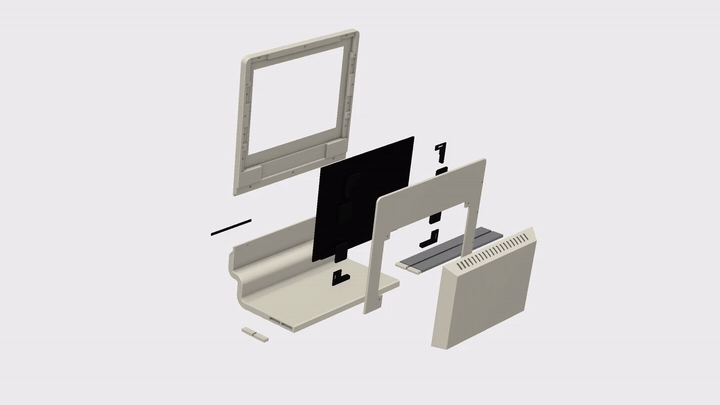

How it goes together. A higher-quality video is in [`docs/assembly.mp4`](docs/assembly.mp4).

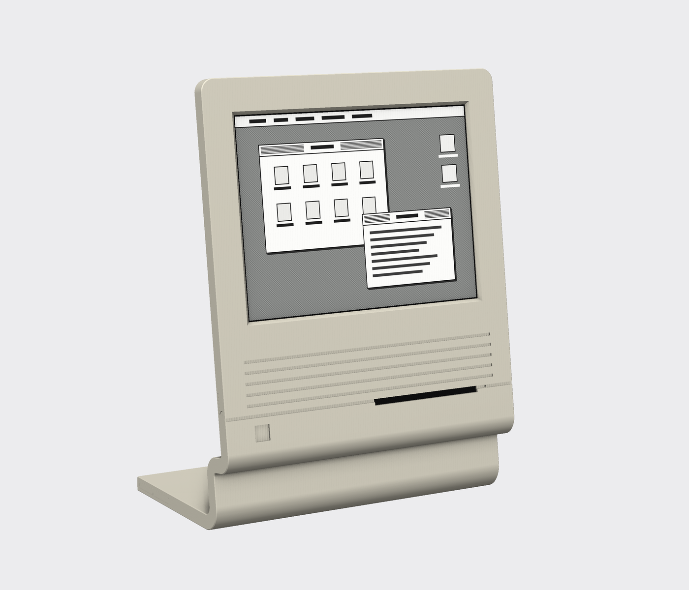

| Rear | Side profile | Chin detail |
|---|---|---|
| 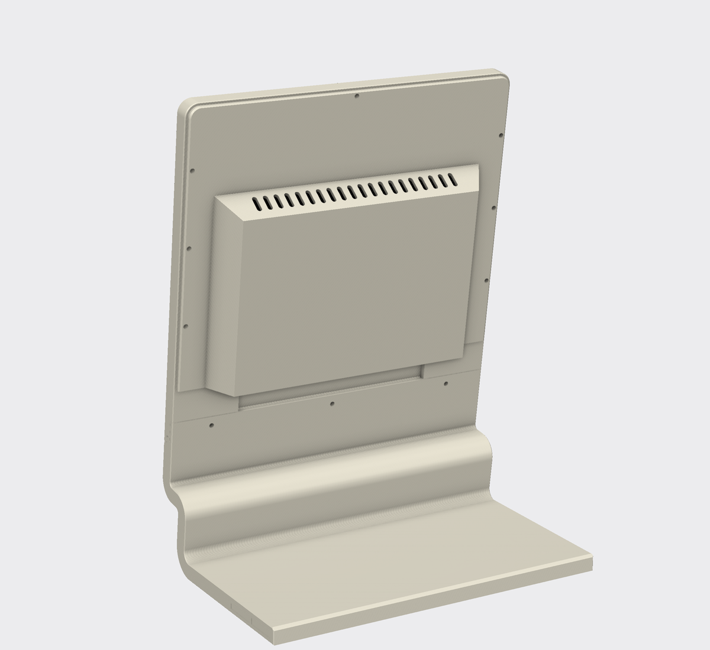 | 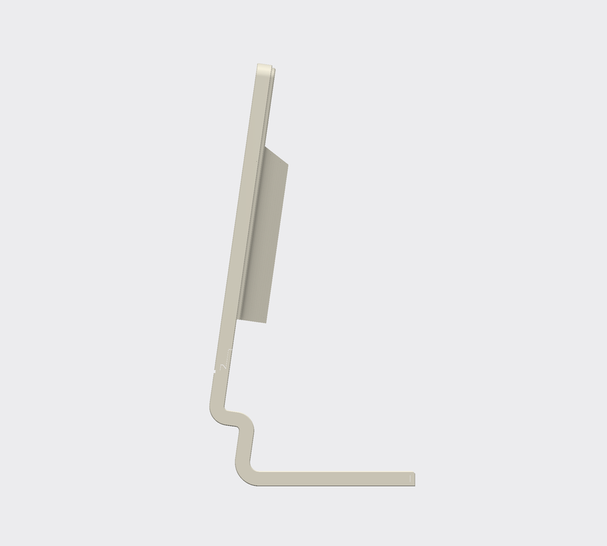 | 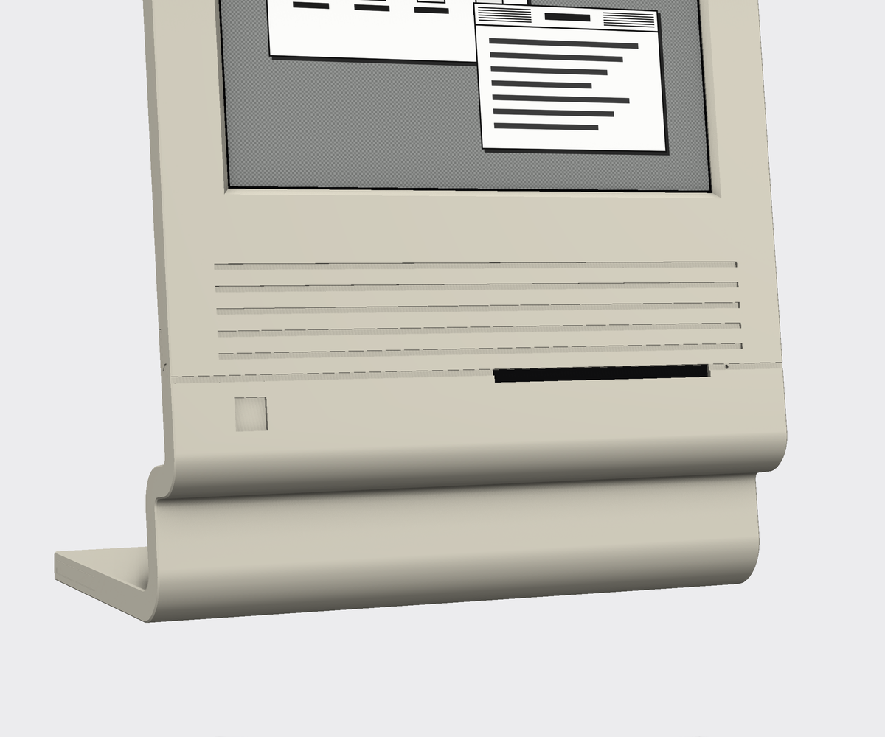 |

## Features

- Designed for printing without supports; the only one needed is a small support under the end of the floppy slot on the base.
- Three-part shell: base, front frame and a two-piece back cover.
- The panel can be positioned in its pocket: four hold-down brackets clamp it, and optional sliding stops set its height and side-to-side position.
- Stops come in three shapes each, so panels with mounting tabs in different places still fit.
- Open-bottom controller bay with no board mounts; boards tape to the back of the LCD. The bay is deep enough for a VGA plug, and slots along its top let the boards' heat out.
- Steel ballast in the foot keeps it from tipping forward.
- Square 12 x 12 mm recess on the chin for a badge of your own.
- Optional cover plate with a carry handle, a squared ledge in the spirit of the compact Macs.

Overall size: 250 W x 162 D x 333 H mm, screen tilted back 8 degrees. The two big parts each need a 250 x 250 x 250 mm build volume.

## What you need

### Printed parts

Files are in [`stl/`](stl/), already in print orientation; the number after `__x` is the quantity.
A ready-to-slice project for the Creality K2 Plus is in [`print/neomac_lcd_case.3mf`](print/).

| Part | Qty | Colour | Print orientation |
|---|---|---|---|
| `base` | 1 | platinum | on its side |
| `front_frame` | 1 | platinum | face down |
| `cover_plate` | 1 | platinum | outer face down |
| `cover_plate_handle` | optional, instead of `cover_plate` | platinum | inner face down (as exported) |
| `bay_lid` | 1 | platinum | ceiling down |
| `lcd_bracket` | 4 | black | as exported |
| `height_stop_*` | 1 left + 1 right | black | as exported; optional, pick a shape (see below) |
| `x_stop_*` | 1 left + 1 right | black | as exported; optional, pick a shape (see below) |
| `floppy_insert` | 1 | black | flat |
| `ballast_plug` | 4 | any | flat |

The original was printed in Polar Filament Retro Platinum PLA with black PLA for the small parts.

### Hardware

| Item | Qty | Used for |
|---|---|---|
| M3 heat-set insert, 5 mm long | 22 | 7 cover, 4 brackets, 4 stops, 4 lid posts, 3 base joint (holes are 4.2 mm x 5.5 mm deep) |
| M3 x 6 button head, ISO 7380 (1.65 mm head) | 15 | cover to frame (7), brackets (4), stops (4). Taller heads will hit the cover over the brackets and stops |
| M3 x 8 countersunk | 4 | cover plate to bay lid |
| M3 x 8 button head | 3 | base to front frame |
| Steel flat bar, 1" x 3/16" (25.4 x 4.76 mm), about 226 mm long | 2 | ballast; must be no longer than 230 mm |
| Thin foam tape, about 1 mm | small piece | pads under the bracket toes |
| Strong double-sided tape | as needed | controller board(s) to the back of the LCD |

### Electronics

- **LCD:** 9.7-inch 1024 x 768 panel from an iPad 1 or iPad 2. The case was designed around a panel measuring 208.0 x 166.7 mm without its mounting tabs.
- **Controller board:** a driver board that supports your panel, with the video input you want (HDMI or VGA are common). These vary a lot and often come as two or three boards; the bay takes them without mounts.
- **Power supply** for the controller board, and video and power cables. Cables leave through the open bottom of the bay.

## Printing

- The 3MF is set up for a Creality K2 Plus with a 0.4 mm nozzle: 0.20 mm layers, 2 walls, 15 % infill, generic PLA. It has five plates: base; front frame; cover plate, bay lid and ballast plugs; brackets and stops; floppy insert.
- **Base:** prints on its side so the whole profile is built as vertical walls. It is the tallest print (250 mm). The 3MF uses 15 % gyroid infill for it and a small painted tree support under the end of the floppy slot, the one overhang in the design. If you slice the STL yourself, add a support there.
- **Front frame:** prints face down, so the face takes the texture of your build plate. Its bottom edge is a plain flat face on the bed.
- **Cover plate with handle:** prints inner face down, so the handle grows straight up; the lip's inner face is angled at 45 degrees so it needs no supports. Its outer face is the top of the print rather than the bed side, so it will look slightly different from the standard plate; ironing helps.
- **Bay lid:** prints ceiling down; its walls lean out 30 degrees from vertical (60 degrees from the bed) and need no supports. The vent slots run up the wall in that orientation, so only their rounded 3.5 mm ends bridge.
- **Stops:** print the shape you need for each corner (see "Fitting the LCD"). Printing all of them is cheap if you are not sure.

### Test before the big prints

[`coupons/`](coupons/) has short slices of the base-to-frame joint, cut from the real parts in their real print orientation. Print a frame slice and its matching base slice first to check the tongue-and-groove fit on your printer (the design uses 0.2 mm clearance) and to try a heat-set insert.

## Assembly

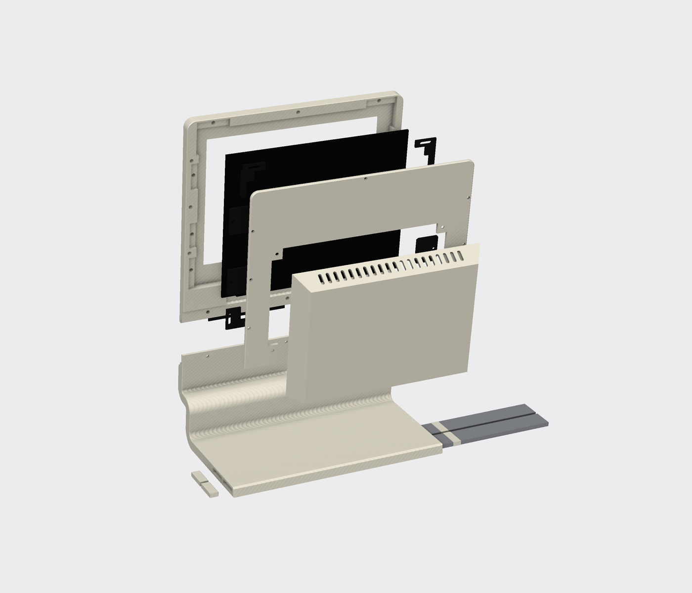

1. **Inserts.** Set all heat-set inserts: three in the bottom of the frame's rear (joint), seven around the frame's rear edge (cover), four in the bracket seats, four in the stop seats, four in the bay lid posts. The inserts behind the face have 2.5 to 3.35 mm of plastic in front of them, so go gently and keep them square.
2. **Ballast.** Slide a steel bar into each channel in the rear of the foot and press a plug into each end.
3. **Base to frame.** Drop the frame onto the base so the tongue enters the groove and the base's rear flange sits in the recess behind the frame. Fix it with three M3 x 8 through the flange into the frame's inserts.
4. **Floppy insert.** Glue the black strip into the floppy slot notch at the top of the base.
5. **LCD.** Lay the panel in the pocket, glass toward the front, with its thicker strip at the bottom. Fit the four hold-down brackets with foam pads under the toes and snug them lightly.
6. **Position.** Power the panel, centre the picture in the opening, then tighten the brackets. If you fitted stops, slide them against the panel and tighten them so the panel goes back in the same place after servicing.
7. **Controller.** Tape the controller board(s) to the back of the LCD, connectors toward the bottom of the bay, and route the cables down through the opening.
8. **Cover.** Screw the bay lid to the cover plate from the inside with four countersunk M3 x 8, then fit the cover to the frame with seven M3 x 6.

### Fitting the LCD

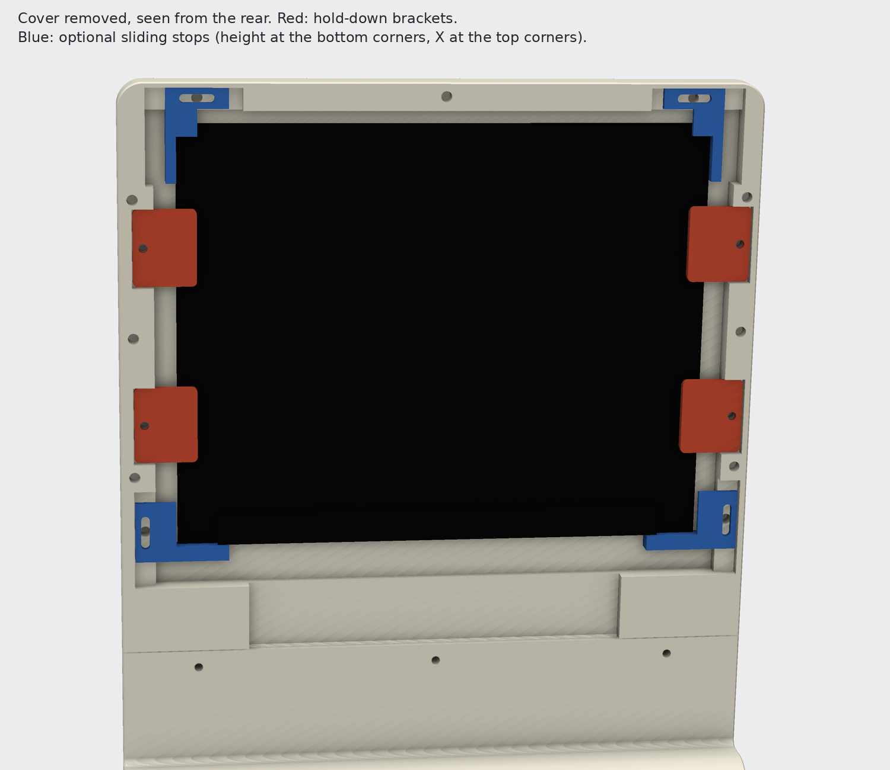

The pocket leaves room around the panel: 4.75 mm past the side tabs on each side, 16.4 mm below and 5.9 mm above the nominal position. The brackets overlap the panel's back edge anywhere in that range.

The screen opening is 199.0 x 149.8 mm. That sits inside the panel's black border, so the panel itself acts as the bezel, with about 1 mm of black showing around the picture. The panel's metal edge is hidden by under 1 mm, so take a moment to centre it.

**Stops.** The height stops slide ±5 mm. The X stops slide 5 mm inward and 4 to 4.5 mm outward. Pick a shape for each corner according to where your panel's mounting tabs are:

| Stop | Shape | Touches the panel edge | Use when |
|---|---|---|---|
| X stop | `full` | top 22 mm of the side edge | no tab near the top corner |
| X stop | `corner` | top 9 mm only | a tab starts 10 mm or more below the corner |
| X stop | `low` | 14 to 30 mm below the top; stands 4.5 mm clear above that | a tab sits right at the top corner |
| Height stop | `standard` | first 20 mm in from the corner | no tab near the bottom corner |
| Height stop | `corner` | first 10 mm only | a tab starts 10 mm or more in from the corner |
| Height stop | `inboard` | 25 to 50 mm in; stands 4.5 mm clear before that | a tab sits within 25 mm of the corner |

"Left" and "right" in the file names are as seen from the front. The stand-off shapes clear tabs up to about 4 mm proud.

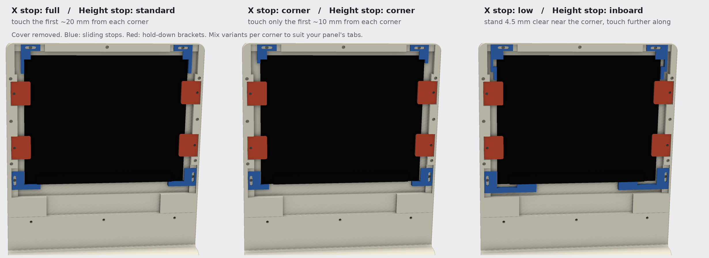

### Controller bay

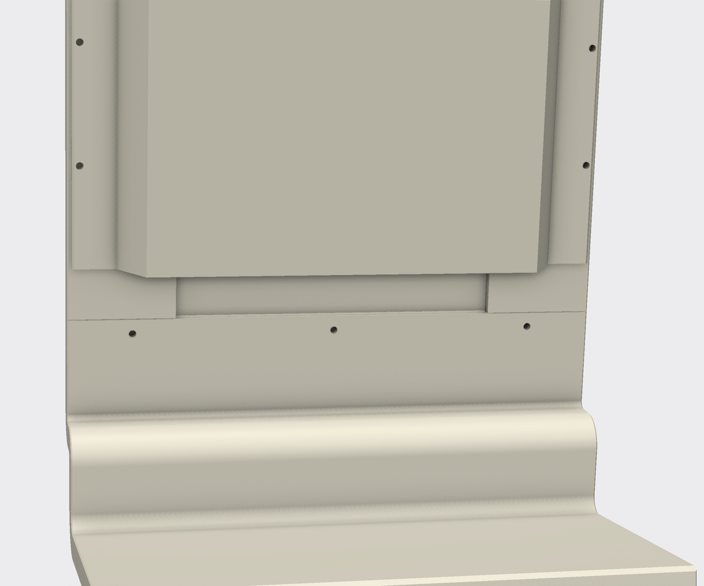

- The opening in the cover plate is about 196 x 133 mm; inside, the bay narrows to about 180 x 125 mm at the ceiling.
- Clear height is about 24 mm above the LCD's thick bottom strip and 27 mm above its thin back. The lid stands 20.4 mm proud of the cover plate.
- Twenty rounded slots (3.5 x 12 mm) cross the lid's sloping top wall. Air comes in through the open bottom and leaves through the slots, so warm air from the boards rises out of the top.

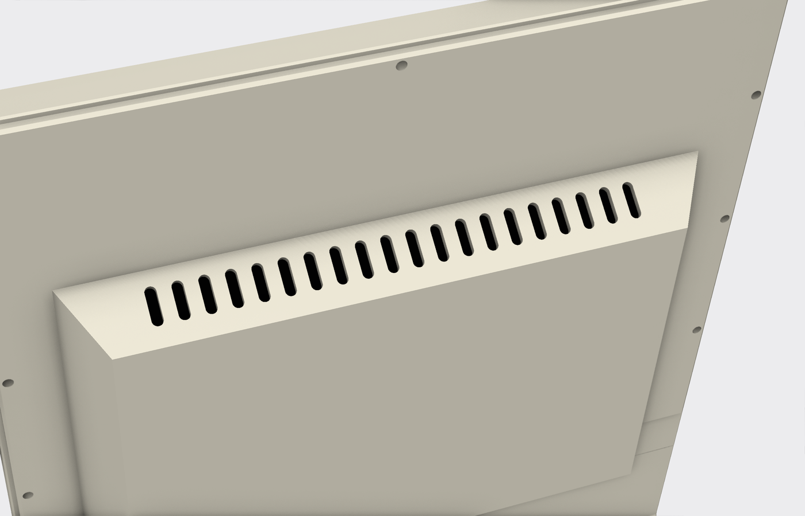
- The bottom is open. Across the middle 150 mm a trough behind the chin deepens the opening to 26 mm, so a VGA plug (32 x 16 mm shell) on a board taped to the LCD drops straight down.

### Optional carry handle

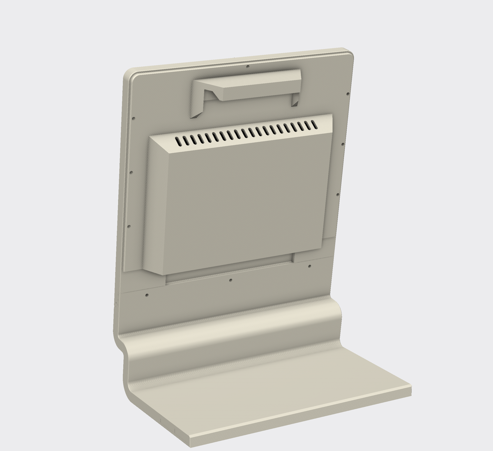

`cover_plate_handle` is the standard cover plate with a handle printed as part of it. It uses the same seven screws and the same bay lid, so it swaps in for `cover_plate` with no extra hardware.

- The ledge is 120 mm wide and stands 30 mm out from the plate, with a 6 mm shelf and a lip that drops 7 mm at its outer edge. Its ends lean in at the bay lid's 30 degrees.
- Fingers come up from below and hook behind the lip. The gap behind the lip is 15 mm at the shelf and 22 mm at the bottom of the lip.
- With the whole monitor (about 1.45 kg with both ballast bars) hanging from it, the shelf root sees about 0.5 MPa, far below what PLA holds across its layers.

| Close-up | Section |
|---|---|
| 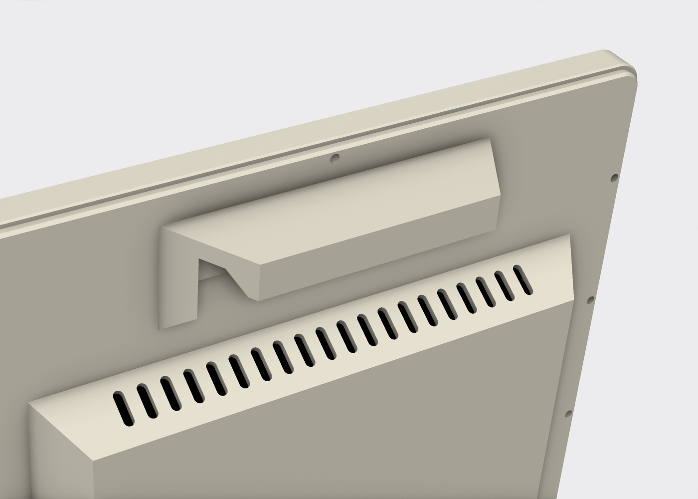 | 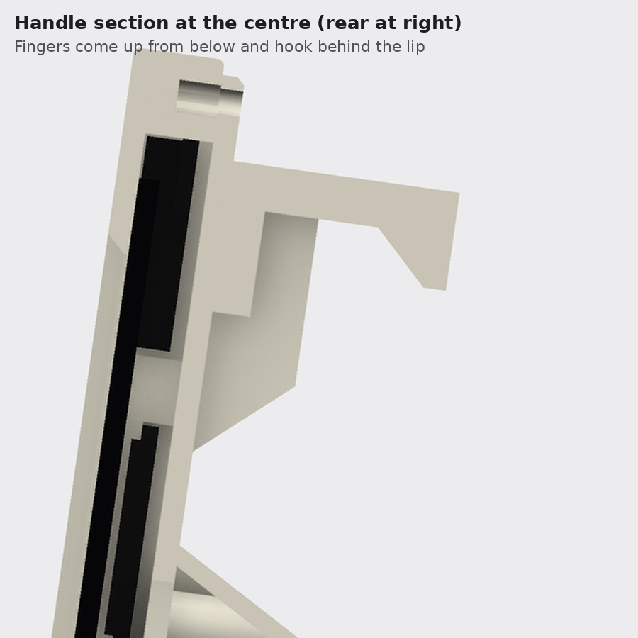 |

### Stability

Estimated tip angles with assumed masses (see [`docs/validation_report.txt`](docs/validation_report.txt)): about 2 degrees forward with no ballast, 11 with one bar and 17 with two. Use both bars.

## Source

The model is generated in Python with [CadQuery](https://cadquery.readthedocs.io). All dimensions are parameters at the top of [`source/neomac.py`](source/neomac.py).

```
git clone https://github.com/wottle/mac_studio_display_se30.git
cd mac_studio_display_se30/source
pip install -r requirements.txt
python export_all.py     # STL, STEP, and geometry checks; ends with ALL PASS
python coupons.py        # joint coupons
python render_final.py   # images in docs/images (needs VTK, which CadQuery installs)
python animate.py        # docs/assembly.mp4 and docs/images/assembly.gif (needs ffmpeg; takes a while)
```

`export_all.py` checks every part for validity and bed fit, tests all parts against each other for interference, probes the clearances that matter (LCD and tabs in the pocket, bracket overlap, stop travel, VGA plug through the bay opening, insert skins), and writes [`docs/validation_report.txt`](docs/validation_report.txt). A STEP assembly with named parts is in [`step/`](step/).

## License

[Creative Commons Attribution-NonCommercial-ShareAlike 4.0](LICENSE) (CC BY-NC-SA 4.0). You may share and adapt it for non-commercial use, with credit, under the same license.

This is a fan project. It is not affiliated with or endorsed by Apple Inc.
